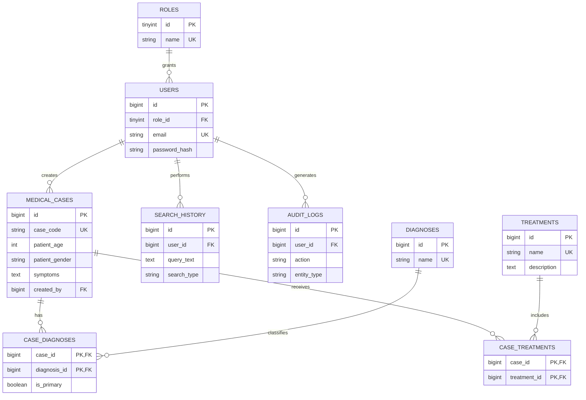

# Database design

## Why three databases

- **MySQL** is the structured system of record. It enforces identities, roles, normalized cases, diagnoses, treatments, search history, and audit relationships.
- **MongoDB** holds clinical structures that vary by case: test panels, examination sections, diagnostic reports, and extra metadata. `caseId` is the cross-database reference; relational data is not duplicated.
- **Qdrant** is a derived search index. It stores one normalized embedding per case plus filterable payload and performs cosine nearest-neighbour search.

## ER diagram

## MongoDB model

`clinical_records`: `{ caseId, laboratoryResults, observations, examinationDetails, diagnosticReports, additionalMetadata, createdAt }`. Unique `caseId`, lab test, and date indexes are defined. The setup script includes an aggregation that groups abnormal laboratory findings by test.

## Qdrant model

Collection `medical_cases`, 384 dimensions, cosine distance. Searchable text concatenates symptoms, medical history, observations, diagnosis, treatment, and notes. Payload supports diagnosis, age, gender, category, and date filtering.
