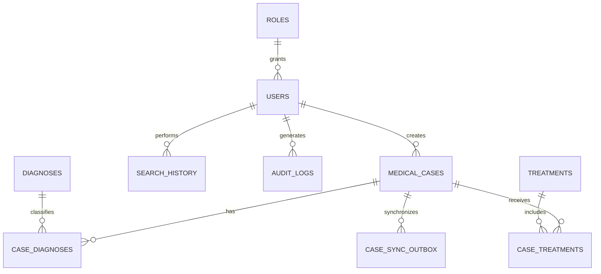

# Database design

## Database choices

MySQL enforces structured identities, normalized cases, relationships, history, audit and durable synchronization intent. MongoDB stores variable laboratory/examination maps without a relational column for each possible test. Qdrant is a derived cosine vector index. Each choice follows the data shape rather than duplicating an entire case everywhere.

## ER diagram

Executable schema: [01](../database/mysql/01_schema.sql), [06](../database/mysql/06_alterations.sql), [08](../database/mysql/08_integrity_and_sync.sql). See [dictionary](data-dictionary.md) for attribute purposes and constraints.

## Relational mapping

- roles(id PK, name UNIQUE, description)
- users(id PK, role_id FK -> roles, full_name, email UNIQUE, password_hash, is_active, created_at, updated_at)
- medical_cases(id PK, case_code UNIQUE, patient_age, patient_gender, category, symptoms, medical_history, clinical_observations, notes, review_status, created_by FK -> users, created_at, updated_at, deleted_at)
- diagnoses(id PK, name UNIQUE, description)
- treatments(id PK, name UNIQUE, description)
- case_diagnoses(case_id PK/FK -> medical_cases, diagnosis_id PK/FK -> diagnoses, is_primary, diagnosed_at)
- case_treatments(case_id PK/FK -> medical_cases, treatment_id PK/FK -> treatments, started_at, outcome)
- search_history(id PK, user_id FK -> users, query_text, search_type, filters_json, result_count, execution_ms, created_at)
- audit_logs(id PK, user_id FK -> users, action, entity_type, entity_id, details, created_at)
- case_sync_outbox(id PK, case_id FK -> medical_cases, operation, payload, attempts, last_error, created_at, processed_at)

Junction tables normalize many-to-many relationships. The current UI assigns one primary diagnosis and one treatment. SQL enforces age 0-120, nonempty clinical fields, enums, unique identities, bcrypt hash format and foreign keys. Application validation adds field errors. App audit records name the actual editor. The trigger audits direct SQL edits and attributes those to the case creator because no authenticated application actor is available.

## MongoDB

clinical_records: `{caseId, laboratoryResults: {summary: string, optionalNumericTest: number, ...}, examinationDetails: {summary: string, ...}, createdAt: Date}`.

[model.json](../database/mongodb/model.json) is installed at first boot and by db:migrate. caseId must be a positive integer-valued number; laboratory values strings/numbers; examination values strings. Indexes: unique caseId and descending createdAt. Aggregation converts the actual laboratory map to key/value entries and counts cases containing each field. Reports/additional metadata are future extensions, not currently collected fields.

## Qdrant and embeddings

Collection medical_cases, 384 dimensions, cosine distance; point IDs equal MySQL case IDs. Payload: caseId, diagnosis, age, gender, category, date. Payload indexes cover gender/category keywords and integer age. Date/diagnosis have no UI filters.

LocalHashEmbeddingService lowercases/splits alphanumeric tokens, hashes weighted buckets and normalizes by magnitude. This is offline feature hashing, not a trained medical model. Changing model/dimensions requires rebuilding a compatible index. Similarity scores do not represent diagnosis confidence.

## Consistency

Case changes and outbox snapshots share a MySQL transaction. MongoDB/Qdrant are eventually consistent projections. Pending events are visible, durable and replayed in order. Case detail reads pending clinical data from the snapshot; similarity hydration excludes pending/deleted cases. See [architecture](system-architecture.md).
