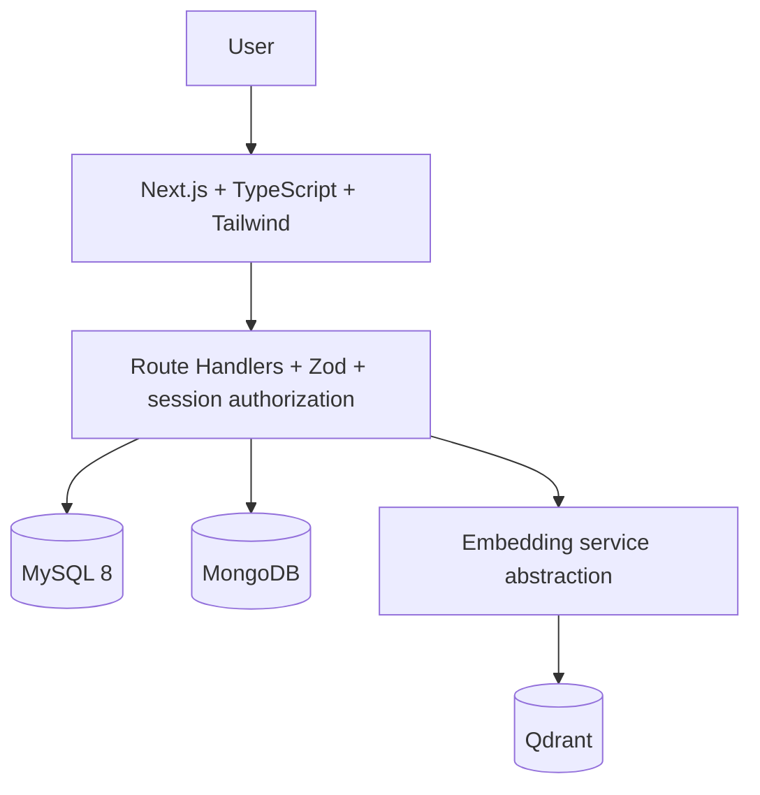
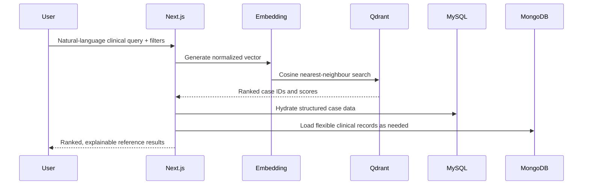

# System architecture

## Similarity flow

The default local embedder uses deterministic feature hashing for offline development. The `EmbeddingService` interface can be replaced by an API-backed provider without changing search orchestration.
