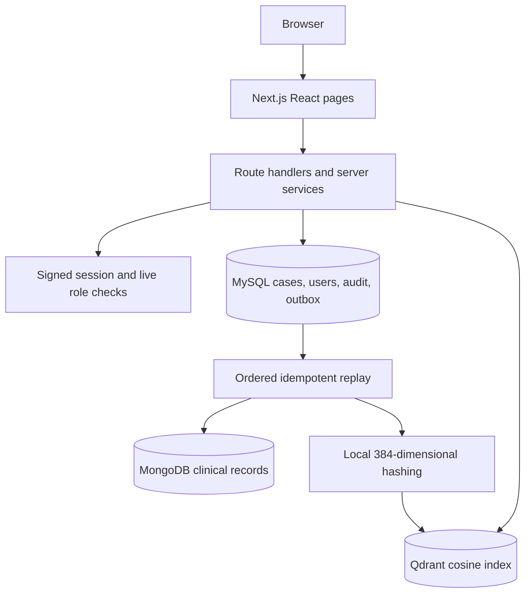

# System architecture

## Case mutations and recovery

The API validates input and live account access. One MySQL transaction writes cases, relationships, audit records and a durable clinical/case outbox snapshot. After commit, replay applies projections to MongoDB/Qdrant. An advisory lock serializes workers. Failed projection writes leave pending events; repeat writes are idempotent. Case detail reads the saved clinical snapshot while pending. Deleted/pending cases are excluded during vector-result hydration.

Cross-database state is eventually consistent, not instantaneously atomic. A crash after external success but before marking an event processed repeats the same operation safely. Persistent failures block later events; retry from Admin or npm run sync after resolving the service/data issue.

## Retrieval and access

Case text combines symptoms, history, observations, diagnosis, treatment and notes. Query text uses the same local hashing embedder. Qdrant applies age/gender/category filters and cosine ranking. MySQL hydrates current cases and stores search history. History reads/deletes are restricted to the signed-in user.

The browser library uses substring filtering. SQL FULLTEXT, views and routines have separate executable demonstrations. Sessions are HttpOnly/SameSite=Lax, Secure in production. API mutations reject explicitly foreign Origins. Live MySQL account checks revoke deactivated users, including existing cookies.
